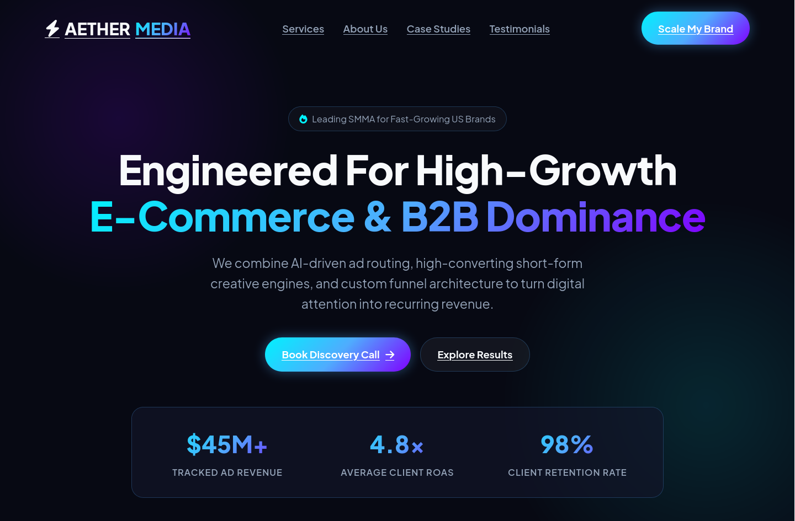

# AetherMedia — SMMA Agency Landing Page

A dark-themed landing page for a social media marketing agency.

**Design Style:** Cyan/blue/purple gradients on dark background. Clean, modern, corporate.

**Sections:**
- Hero with stats ($45M+ revenue, 4.8x ROAS)
- Interactive service tabs (Paid Ads, Content, Funnels, Influencer)
- About with value cards
- Case studies (3 client cards)
- Testimonials
- Contact form (fake)

**Tech:** HTML, CSS, vanilla JS, Font Awesome, Google Fonts (Plus Jakarta Sans)

**Notes:** Built with AI assistance (Gemini + DeepSeek) as a design experiment.

**Live Demo:** `https://0x9z.github.io/landing-pages/aethermedia/`