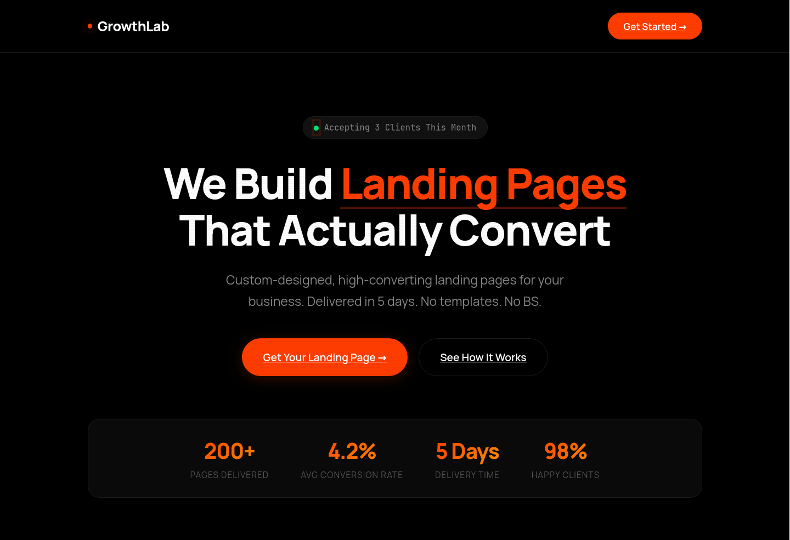

# GrowthLab — Landing Page Service

A gritty, orange/black landing page for a landing page design service.

**Design Style:** Scanline effect, JetBrains Mono labels, aggressive copy. Feels developer-made.

**Sections:**
- Hero with proof bar (200+ pages, 4.2% conversion)
- Problem cards (amateur look, slow loading, no conversions)
- Single service box with pricing ($1,497)
- How it works (4 steps)
- Money-back guarantee
- FAQ grid
- Final CTA

**Tech:** HTML, CSS, vanilla JS, Manrope + JetBrains Mono

**Notes:** Built with AI assistance. Most original design of the four.

**Live Demo:** `https://0x9z.github.io/landing-pages/growthlab/`
