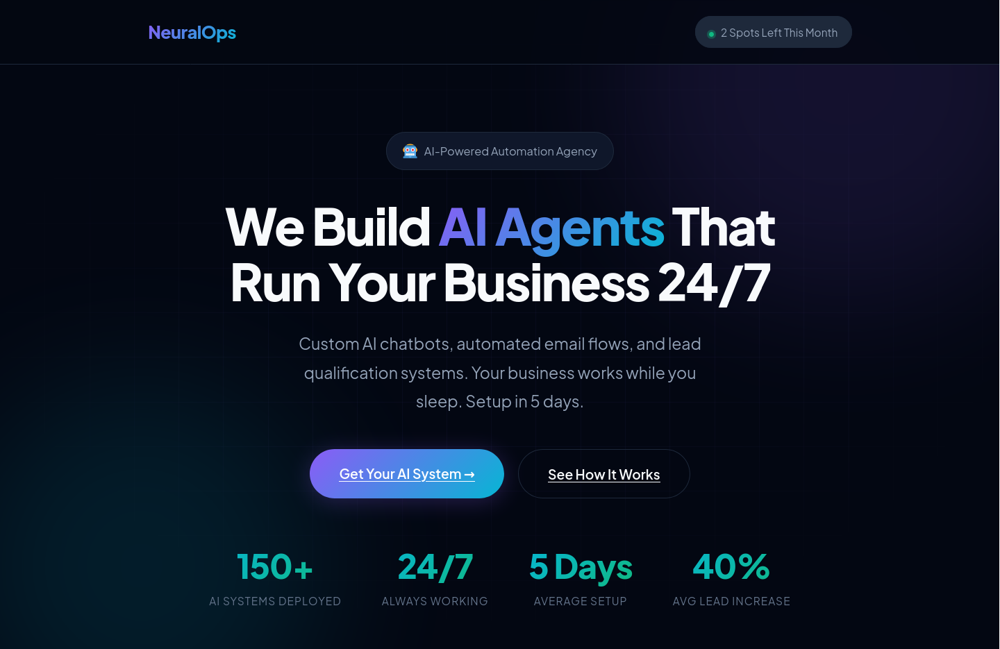

# NeuralOps — AI Automation Agency Landing Page

A dark-themed landing page for an AI automation agency.

**Design Style:** Purple/cyan on deep blue. Clean, conversion-focused, with subtle grid overlay.

**Sections:**
- Hero with stats (150+ systems, 24/7, 5 days setup)
- Problem cards (pain points)
- Offer box with pricing ($2,497 + $497/mo)
- Process cards (4 steps)
- ROI calculator section
- FAQ grid
- Final CTA with urgency badge

**Tech:** HTML, CSS, vanilla JS, Plus Jakarta Sans

**Notes:** Built with AI assistance. Strongest copywriting of the four templates.

**Live Demo:** `https://0x9z.github.io/landing-pages/neuralops/`
