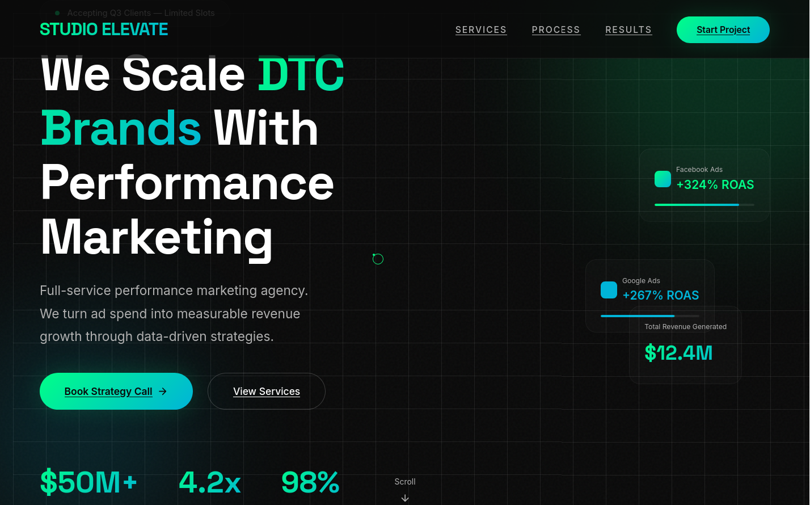

# Studio Elevate — Performance Marketing Landing Page

A neon-green/black landing page for a performance marketing agency.

**Design Style:** Cyberpunk-inspired. Custom cursor, animated grid background, floating orbs, glassmorphism.

**Sections:**
- Hero with floating ad cards and stats
- Services grid (6 cards with hover effects)
- Process timeline (4 steps)
- Testimonials
- CTA with glow effect

**Tech:** HTML, CSS, vanilla JS, Space Grotesk + Inter fonts

**Notes:** Built with AI assistance. The custom cursor only works on desktop.

**Live Demo:** `https://0x9z.github.io/landing-pages/studio-elevate/`
